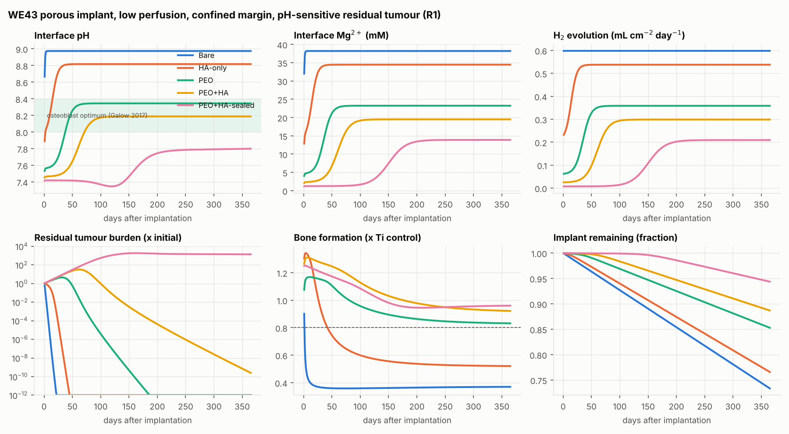
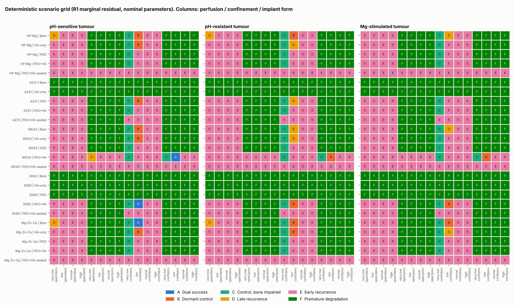
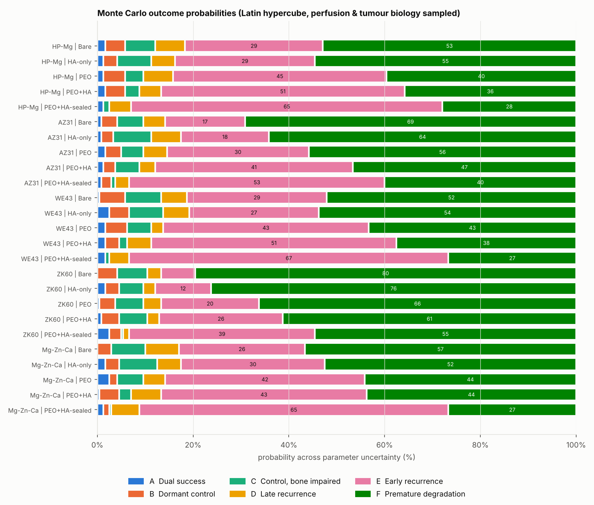
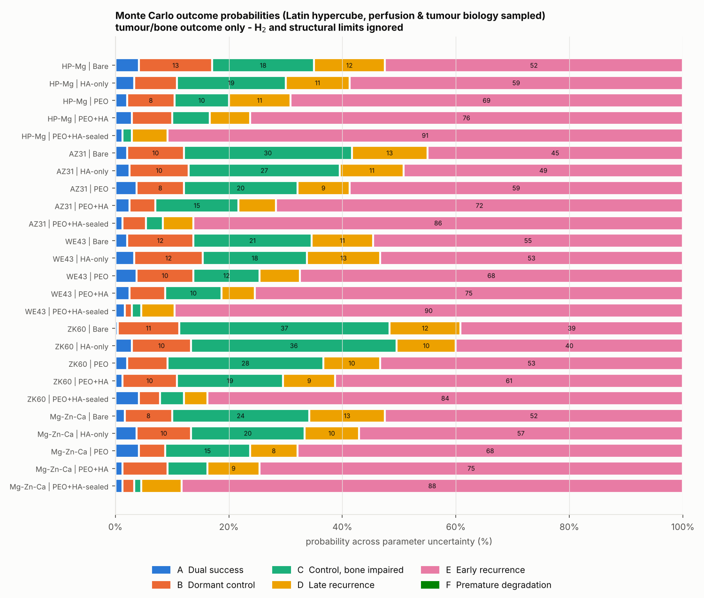
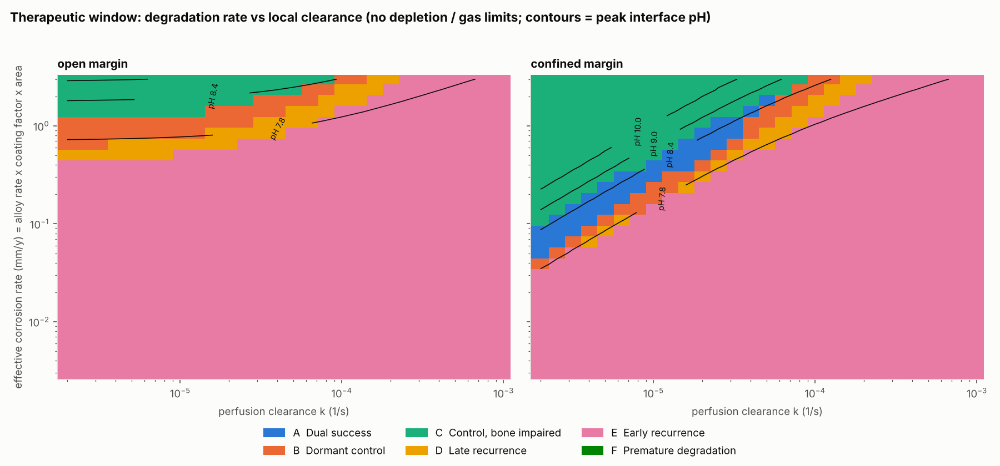
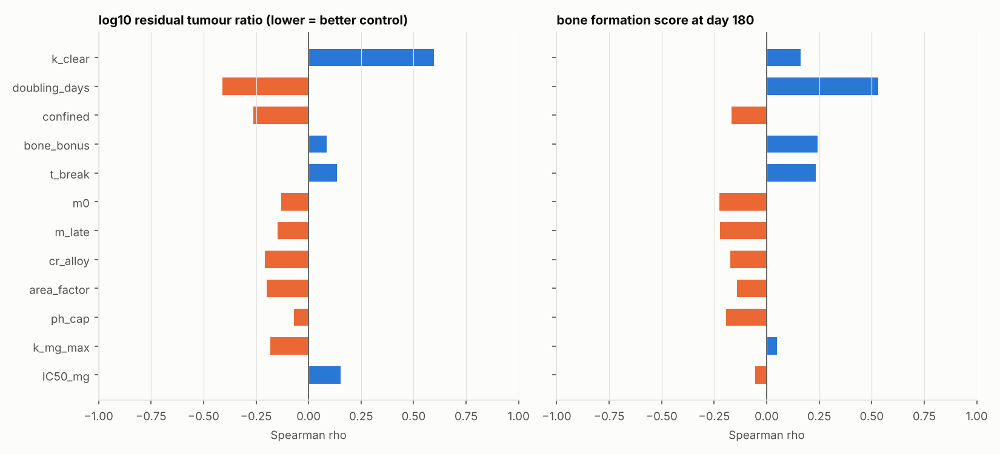

# Mg-alloy / PEO / HA implants after bone-tumour resection: an outcome simulator

After a bone tumour is resected, the implant that fills the defect has two
jobs that can pull against each other:

1. **Support new bone** (osteoconduction, mechanical support while the bone heals).
2. **Stop residual tumour cells at the margin from regrowing** (local recurrence).

Biodegradable Mg alloys are candidates for both jobs. Corroding Mg releases
**Mg²⁺** (osteogenic at a few mM [Yoshizawa2014, Zhang2016]) and **OH⁻**
(local alkalinisation that is cytotoxic or cytostatic to osteosarcoma cells
in vitro [Zhang2012, Li2014, Globig2022]). PEO/MAO and HA coatings slow that
release and change the interface chemistry [Narayanan2014, Lamaka2018].
Nobody has quantified how much alkalinity and Mg²⁺ actually reach residual
tumour cells in vivo. This repository is a mechanistic, literature-parameterised
model that **enumerates the possible outcomes** and shows which conditions lead
to each.

> **Scope.** This is a hypothesis-generating model. Many parameters come
> from in vitro studies or are explicit assumptions (tagged `ASSUMPTION` in
> `mgsim/parameters.py`). Read its outputs as a map of plausible regimes and of
> the measurements that would decide between them, not as predictions for a
> patient. See [Limitations](#limitations).

All citations: [REFERENCES.md](REFERENCES.md).

---

## Model

1-D reaction–diffusion along a 5 mm resection margin, measured outward from
the implant surface (`mgsim/model.py`).

```
 implant | interface |------------- peri-implant margin (0..5 mm) -------------| edge
  Mg --> Mg2+ + 2OH- + H2      diffusion + perfusion clearance             open: serum levels
  coating factor m(t)          tumour cells T(x,t)  (acid producers)       confined: zero flux
  pH ceiling (Mg(OH)2 / CaP)   new bone O(x,t)
```

| Layer | What is modelled | Basis |
|---|---|---|
| Corrosion | Flux `J = CR·ρ/M · area · m(t)`; 1 Mg²⁺ + 2 OH⁻ + 1 H₂ per Mg | [Song1999] |
| Coatings | `m(t)` goes sigmoidally from a barrier value `m0` to `m_late` at breakdown time `t_break` | PEO [Matykina2016, Narayanan2014, Gu2011]; HA [Hornberger2012, Song2010, FattahAlhosseini2023] |
| Interface pH ceiling | 10.4 (Mg(OH)₂); 8.3–9.4 while a Ca-P/HA layer persists | [Lamaka2018] |
| Transport | Implicit diffusion of Mg²⁺ and base; first-order perfusion clearance; bicarbonate buffer `pH = 7.4 + b/β` | [Swietach2014] |
| Tumour | Logistic growth; cytostatic (dormancy) effect of alkalinity; cytotoxic kill at high pH; Mg²⁺ kill above ~10 mM; optional Mg²⁺-driven proliferation; tumour cells acidify their surroundings | [Globig2022, Zhang2012, Li2014, Burmester2014, WolfTrapani2008, Webb2011, GatenbyGawlinski1996] |
| Bone | Osteogenic rate × Mg²⁺ factor (rises then falls with dose) × pH factor (optimum ~8.2, toxic above ~9.3) × H₂-gas factor × HA bonus × space not taken by tumour; alkaline injury term | [Yoshizawa2014, Zhang2016, Wang2015, Galow2017, Song2007, Hornberger2012] |
| Implant | Penetration depth vs strut half-thickness (structural reserve) | — |

### Outcome classes

Each simulation (365 days) ends in exactly one class:

| | Outcome | Definition |
|---|---|---|
| A | **Dual success** | Residual tumour eradicated, and bone formation at day 180 is at least 80% of an inert Ti control |
| B | **Dormant control** | Tumour suppressed but viable cells remain, so it can relapse once the Mg is used up; bone OK |
| C | **Control, bone impaired** | Tumour controlled, but alkalinity, Mg²⁺ or H₂ pushed bone formation below 80% |
| D | **Late recurrence** | Detectable regrowth between day 180 and 365, after coating breakdown or implant exhaustion |
| E | **Early recurrence** | Detectable regrowth within 180 days: degradation too slow, or tumour too resistant |
| F | **Premature degradation** | Less than 50% of the implant left at 12 weeks, or H₂ above 5× tolerance for at least 28 days |

### Scenario axes

| Axis | Levels |
|---|---|
| Alloy (in vivo bare rate, mm/y) | HP-Mg, AZ31, WE43, ZK60, Mg-Zn-Ca |
| Coating | Bare, HA-only, PEO, PEO+HA, PEO+HA-sealed |
| Perfusion clearance | very-low (irradiated / poorly vascular bed), low, normal, high |
| Margin geometry | open (healthy perfused tissue at 5 mm) vs confined (capsule, closed cavity, haematoma) |
| Implant form | dense vs porous scaffold (3× surface area) [Hakimi2016] |
| Tumour phenotype | pH-sensitive, pH-resistant, Mg-stimulated |
| Residual burden | R0-micro (1e-5 of carrying capacity), R1-marginal (1e-3) |

The **deterministic grid** covers all 2,400 combinations at nominal values.
The **Monte Carlo** draws a Latin hypercube over every uncertain parameter
range (25 alloy × coating pairs × 240 samples = 6,000 runs).

---

## Run it

```bash
pip install -r requirements.txt
python run_all.py          # full study, ~15-20 min on 4 cores
python run_all.py --quick  # smaller Monte Carlo for a fast check
python -m pytest -q        # sanity tests (stoichiometry, buffering, pH caps, trade-off)
```

Outputs:

- `results/scenario_grid.csv`: one row per grid scenario, with outcome, peak pH and Mg²⁺, H₂, bone score, recurrence day
- `results/monte_carlo.csv`: every Monte Carlo sample, with its sampled inputs (`in_*`)
- `results/summary.md`: auto-generated tables (outcome shares, probabilities, sensitivity)
- `figures/fig1..fig5*.png`

Single run from Python:

```python
from mgsim import build_params, simulate
p = build_params("WE43", "PEO+HA", perfusion="low", phenotype="pH-sensitive",
                 residual="R1-marginal", form="porous", confinement="confined")
r = simulate(p, record=True)
print(r["outcome"], r["peak_interface_pH"], r["bone_score_180"])
```

---

## Results

Full tables: [`results/summary.md`](results/summary.md). Numbers are from
`python run_all.py` (2,400 grid scenarios + 6,000 Monte Carlo runs + a
28 × 28 × 2 window sweep).

| Figure | Shows |
|---|---|
|  | **Fig 1.** The same WE43 porous implant with each coating (low perfusion, confined margin). Bare and HA-only kill the tumour, but bone falls to 0.4–0.5× Ti. PEO+HA reaches pH ~8.2, eradicates the tumour slowly, and keeps bone above 0.9×. The sealed PEO+HA coating keeps pH near 7.4 and the tumour regrows. |
|  | **Fig 2.** Outcome of every grid scenario (R1 residual) |
|  | **Fig 3.** Monte Carlo outcome probabilities, with the gas/structural limit applied |
|  | **Fig 3b.** Tumour/bone outcome only (H₂ limit ignored) |
|  | **Fig 4.** Therapeutic window: effective corrosion rate vs perfusion |
|  | **Fig 5.** Spearman sensitivity of tumour control and bone score |

### What the simulations say (hypotheses to test, not conclusions)

1. **The local environment matters more than the choice of alloy or coating.**
   Perfusion clearance is the strongest driver of tumour control
   (Spearman ρ = +0.60 against residual tumour). Next come tumour doubling
   time (−0.41) and whether the margin is confined (−0.26). Alloy rate
   (−0.21) and coating barrier (−0.13 to −0.15) come after those.
   Across the grid, with gas ignored, *dual success* occurred only in
   **confined margins with low or very-low perfusion**: 12% of
   confined/low-perfusion scenarios, and 0% of open or normally perfused ones.

2. **In vivo dilution can explain why in vitro antitumour effects may not
   carry over.** In an open, perfused margin the peak interface pH never
   exceeded **8.0**, and Mg²⁺ stayed at 1.5–30 mM, even for bare ZK60. That
   is well below the alkalinity that killed U2-OS and MG-63 cells in extract
   studies [Zhang2012, Li2014]. The same implants in a confined, poorly
   perfused bed reached pH **8.5–10.4** and 23–67 mM Mg²⁺. The in vitro / in
   vivo gap [Kirkland2012] therefore applies to the antitumour claim as well
   as to the corrosion rate.

3. **There is a narrow therapeutic window at peak interface pH ≈ 8.4–9.0
   (Fig 4).** Below it the tumour grows back (early or late recurrence).
   Above it the tumour is controlled but bone formation drops (outcome C).
   This band overlaps both the osteoblast optimum near pH 8.4 [Galow2017]
   and the cytostatic/dormancy range [Globig2022]. That overlap is why a
   dual-function implant is plausible at all. The window is a diagonal band:
   the required corrosion rate scales roughly with perfusion. So **no single
   corrosion rate is right for every patient.**

4. **Each coating moves the outcome mix in a different direction (Fig 3b).**
   - *Bare / HA-only* (fast): most tumour control, but the most bone
     impairment (C = 18–37%) and the most H₂ breaches (52–80%).
   - *PEO / PEO+HA* (intermediate): the most balanced. PEO+HA also caps the
     interface pH at 8.5–9.2 while the HA layer lasts [Lamaka2018], which
     happens to cut off the bone-toxic overshoot while leaving the cytostatic
     range intact. This is the main mechanistic argument for PEO+HA.
   - *PEO+HA-sealed* (slow): the best bone and gas profile, but 84–91% early
     recurrence. Too much protection removes the antitumour effect.

5. **H₂ gas is probably the binding constraint.** Using a Song2007-anchored
   tolerance, 27–80% of Monte Carlo runs per alloy/coating breach the gas
   limit. In the grid, 84% of porous (3× area) scaffolds do. Porosity raises
   cytotoxicity [Hakimi2016], and it raises gas just as much. Every
   *Premature degradation* call in the grid was caused by gas; none was
   structural.

6. **Dormancy and late recurrence are real possibilities.** Between 5% and
   13% of runs per alloy/coating end in suppression without eradication
   (outcome B) or regrowth after day 180 (outcome D). Once the coating breaks
   down and the alkaline flux settles, the suppressed cells can resume
   growth, in line with the dormancy phenotype reported by [Globig2022].
   Preclinical follow-up therefore needs to run beyond implant resorption.

7. **Tumour biology changes the boundaries more than it changes the
   ranking.** pH-resistant and Mg-stimulated phenotypes
   [WolfTrapani2008, CastiglioniMaier2011] move several *dual success*
   scenarios into dormant control or late recurrence (Fig 2), but the
   ranking of coatings stays the same.

8. **Overall, Mg degradation alone controls a macroscopic R1 residual in
   only a minority of plausible conditions.** The most probable single
   outcome across the uncertainty is early recurrence. The model therefore
   supports using degradation as an *adjunct*, with a tuned PEO+HA barrier
   plus drug loading or adjuvant therapy, which is the direction recent
   designs take [Review2024].

### Measurements that would collapse the uncertainty

These are ranked by sensitivity. Each one replaces a sampled range with data.

1. **Local clearance and pH in the resection bed in vivo**, for example with
   implanted pH/Mg²⁺ microsensors or [Lamaka2018]-style micro-probes in an
   animal resection model, compared between irradiated and non-irradiated
   beds. This fixes `k_clear` and `confined`.
2. **Dose–response of osteosarcoma cells to pH and to Mg²⁺ separately**, in
   bicarbonate-buffered (not HEPES-only) media under 5% CO₂, measuring both
   cytostasis (Ki-67) and death. This fixes `pH50_static`, `pH50_kill` and
   `IC50_mg`.
3. **The same dose–response for primary osteoblasts / BMSCs**
   [Burmester2014 shows cell lines mislead]. This fixes `ph_opt`, `ph_tox50`
   and `mg_tox_IC50`.
4. **Coating kinetics in vivo**: H₂ and Mg release over time for PEO and
   PEO+HA on the target alloy, giving `m0`, `t_break` and `m_late`.

Each of these can be dropped into `mgsim/parameters.py` as a narrower
`Range`. Re-running `run_all.py` then updates every outcome probability.


---

## Limitations

- **1-D, continuum, deterministic biology.** No immune response, angiogenesis,
  osteoclasts, mechanics or individual-cell stochastic extinction. "Eradication"
  means the continuum density fell below 1e-9 of carrying capacity.
- **Most dose–response curves are in vitro** (cell lines in HEPES- or
  extract-based media). In vivo buffering, protein adsorption and the immune
  system are likely to shift them.
- **In vivo corrosion rates and perfusion of a post-resection bed are poorly
  constrained.** That is exactly why the model sweeps them, and why they
  dominate the sensitivity analysis.
- **Coating behaviour is simplified** to a barrier factor with a single
  breakdown time. Galvanic effects, coating cracks, localised or pitting
  corrosion and alloying-element ions (Zn, rare earths, Al) are not modelled.
- **No chemotherapy or radiotherapy coupling.** Adjuvant therapy would shift
  the tumour axis. Irradiated beds are represented only through low perfusion.
- The outcome thresholds (80% bone, detection density 0.05, structural 50% at
  12 weeks, H₂ at 5× tolerance) are conventions and can be changed in `model.py`.
